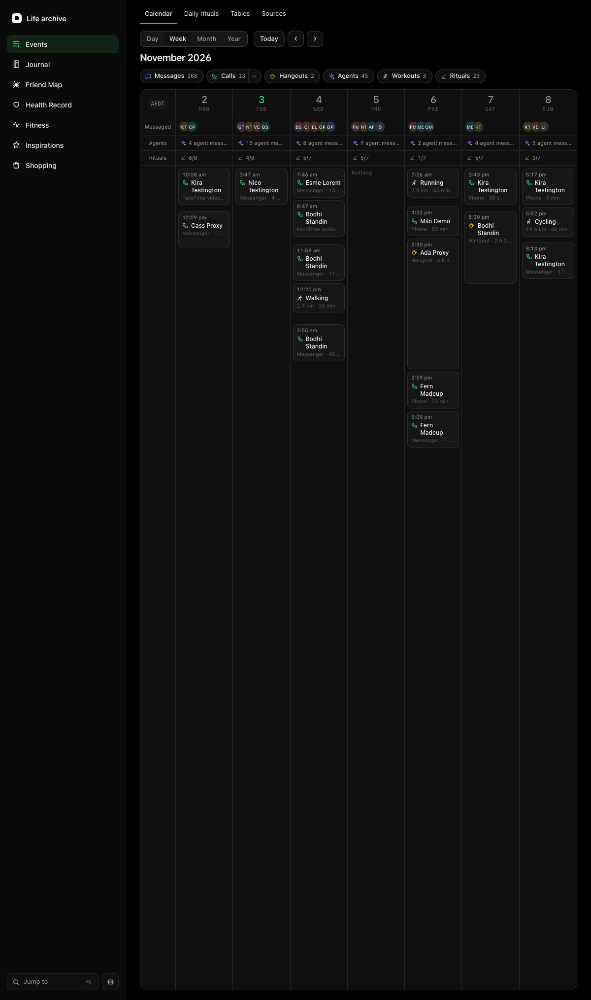

# Life archive

A personal archive of a life, kept on your own computer: every message, call and hangout from your chat apps, your
conversations with coding agents, your workouts, health results, journals, daily rituals and the things you save for
later, in SQLite databases in one folder, with the code that imports them, keeps them in sync and shows them.

It is one server and a page in the browser. The core keeps the event index and the calendar every part writes into,
and your agents' sessions; **modules** add the rest, and you switch off the ones you do not want.
Your data never goes into this repository: it lives in a folder of its own, outside the code.



*Everything in the picture is made up: the testing data the repository builds for itself.*

**See it running:** a public demo, the console over that made-up data in your browser, read-only (the Events page
and Friend Map for now), is planned but not published yet. `npm run build:demo` builds it and `npm run serve:demo`
serves it on your own machine ([docs/demo.md](docs/demo.md)).

## What is in it

| Part | What it does |
| --- | --- |
| **Events** (core) | Every kind of event in one calendar (day, week, month, year) and one table each, and the status of every source. The home page. |
| **Friend Map** (`modules/friend-map/`) | The social layer: messages, calls and hangouts from Messenger, Instagram, WhatsApp, iMessage, Telegram, Signal, Discord, X, WeChat and the phone, everyone in them as people you name, tag and join, and friend-map's map of them. |

Those two are what a new archive offers. The rest are unfinished: off, and out of the menu, unless switched on by name
in `settings.json` (SETUP.md's "Choose the modules"; `"pages": "all"` turns every one on):

| Part | What it does |
| --- | --- |
| **Inspirations** (`modules/inspirations/`) | Links, posts and pictures you save for the ideas in them, tagged by what they are about. |
| **Fitness** (`modules/exercise/`) | Workouts from Polar, as a training log with heart-rate zones and routes on a map. |
| **Health Record** (`modules/health/`) | Blood tests and other results, each judged against one stated reference range. |
| **Journal** (`modules/journal/`) | An Obsidian vault, and voice memos transcribed into it each morning. |
| **Rituals** (`modules/rituals/`) | Daily habits and weekly targets, logged by your assistant and shown as rows of dots. |

Every module is a folder under `modules/` with a README of its own. `docs/modules.md` says how one is built, and how
to keep a private one of your own beside them (git ignores any folder under `modules/` it does not name).

**Your agents connect to it as an MCP server** (`/life-archive/mcp`), each with a key of its own: one line in Claude
Code, Codex or Grok, and its first call, `start_here`, says what your archive holds today and which tools that agent
may use. Facts are open to every key; content and writes only to the agents you grant them
([docs/agents.md](docs/agents.md)).

## Try it on made-up data

You need Node 24.22.1 (`.node-version`; any version manager that reads it, or the Vite+ shims) and git.

```sh
git clone <this repository> life-archive && cd life-archive
npm ci
npm run testing-data -- /tmp/life-archive-testing --crowd
LIFE_ARCHIVE_DATA=/tmp/life-archive-testing LIFE_ARCHIVE_URL=http://127.0.0.1:4651 npm start
```

Then open <http://127.0.0.1:4651/life-archive/>, and friend-map's page at <http://127.0.0.1:4651/friend-map/>.
The testing data is about 120 made-up people over two and a half years, with their chats, calls and hangouts, made-up
agent sessions, workouts, health results, a rituals store and inspirations.

## Make it yours

**[SETUP.md](SETUP.md)** walks you, or your coding agent, through setting up your own archive on macOS or Linux: the
folder, the settings, which modules and connectors to switch on, bringing your data in, and keeping the server running.

macOS is where it was built and is the most complete: the iMessage, phone-call and WhatsApp-for-Mac importers and the
scheduled jobs need it. On Linux the server, the page, the export-fed importers and the tests run; SETUP.md lists what
does not yet.

## Privacy

Your archive holds other people's words. The project's privacy policy (`server/privacy/policy.ts`, as text in
[docs/privacy.md](docs/privacy.md)) keeps it in three layers: **content** (message text, media, notes), which an AI
model reads only when you ask, every such read logged, and other people's messages by default only a model running
on your own machines; **metadata** (names, times, counts), which it may read
freely; and what a **repository** may hold, which is code and made-up data only. The commands that read content take
the reason as an argument and write it to a trail you can read back. [AGENTS.md](AGENTS.md) holds the rules every
coding agent working here follows.

## Documents

- [SETUP.md](SETUP.md): setting up your own archive, step by step
- [docs/running.md](docs/running.md): running the server, the tests, the testing data
- [docs/settings.md](docs/settings.md): `settings.json` and `.env.local`
- [docs/data.md](docs/data.md): the archive's folder, the platforms' exports, the scheduled jobs, the backups
- [docs/import-runbook.md](docs/import-runbook.md) and [docs/platforms.md](docs/platforms.md): bringing each platform in
- [docs/people.md](docs/people.md): how everyone is kept as a person, and changing people from a chat
- [docs/archive.md](docs/archive.md): the message archive and its commands
- [docs/events.md](docs/events.md): the event index, the calendar, folder history
- [docs/queries.md](docs/queries.md): the query language, SQL and the AI service
- [docs/console.md](docs/console.md): the viewer and the console
- [docs/features.md](docs/features.md): each module and each of the core's pages
- [docs/modules.md](docs/modules.md): how a module is built
- [docs/demo.md](docs/demo.md): the public demo, how it is built and checked, and publishing it
- [docs/agents.md](docs/agents.md): the MCP door: connecting an agent, its key and grants, the tools
- [docs/privacy.md](docs/privacy.md) and [docs/guard.md](docs/guard.md): the privacy policy and the commit guard
- [docs/wiring.md](docs/wiring.md) and [docs/architecture.md](docs/architecture.md): how it is wired
- [docs/effect.md](docs/effect.md): how the server code is written

**A word used throughout:** *the captain* is the person whose archive it is, its owner. The documents and the
commands' messages say "the captain" and "his"; read them as "you" and "yours".

## Licence

MIT ([LICENSE](LICENSE)).
